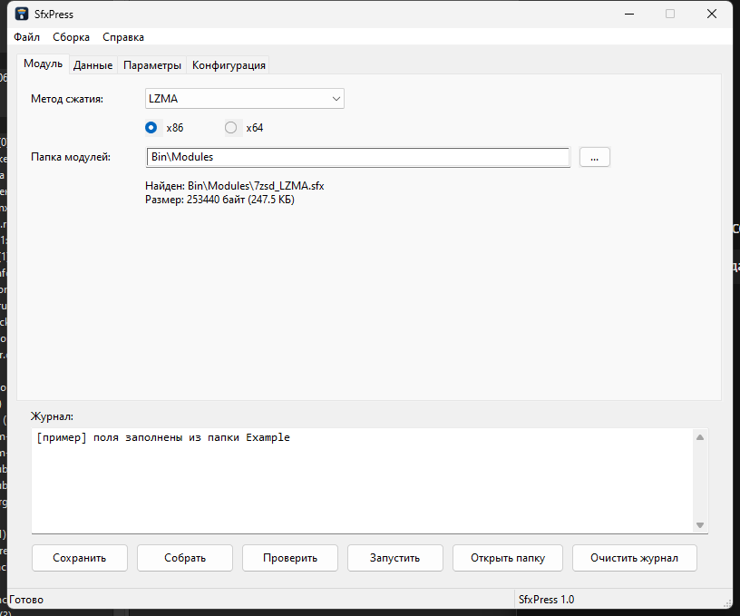

# SfxPress — конструктор SFX-инсталляторов (C++ / Win32)

SfxPress собирает самораспаковывающиеся установщики (SFX) для модифицированного
7zSFX-модуля: модуль `.sfx` + конфигурация в UTF-8 + архив 7z склеиваются в один exe.
Чистый C++ и Win32 API — без Qt, MFC и .NET.



Портативный комплект: `SfxPress.exe`, `Bin\7z.exe` (7-Zip 26.06), `Bin\Modules\*.sfx`,
справки в `Bin\*.chm`, готовый пример в `Example\`.

## Что уже работает

- выбор модуля: метод (Base / LZMA / LZMA2 / Deflate / PPMd / All) и разрядность (x86 / x64);
- проверка наличия модуля и показ его размера;
- payload: готовый `.7z` или **папка** — папка упаковывается автоматически
  во временный архив, который удаляется после сборки;
- поиск `7z.exe`: рядом с конструктором → `%ProgramW6432%`, `%ProgramFiles%`,
  `%ProgramFiles(x86)%`, `%LOCALAPPDATA%\Programs` → реестр `HKLM\SOFTWARE\7-Zip`
  (и `WOW6432Node`) → `PATH`;
- drag&drop папки или файла на окно — путь попадает в поле payload;
- параметры: `InstallPath`, `RunProgram`, `Delete`, `GUIMode`, `SingleInstance`,
  `BeginPrompt`, `Password`, `SfxAuthor`, `Archive`, `PreExtract`, `ExecuteOnLoad`;
- генерация конфигурации с правилами модуля: `\\`, `\"`, `\n`, `\t`;
- проверка перед сборкой: `SingleInstance` требует `InstallPath`,
  модуль + конфигурация должны укладываться в 2 МБ;
- сборка: `[модуль .sfx] + [конфигурация UTF-8] + [архив]`;
- контроль результата: поиск сигнатуры `37 7A BC AF 27 1C` и сверка её смещения
  с суммой «модуль + конфигурация»;
- журнал операций и строка состояния;
- профиль проекта (INI): «Файл → Сохранить/Загрузить профиль»;
- вкладка «Конфигурация» — предпросмотр того, что будет записано в exe;
- сборка без интерфейса для скриптов (см. ниже).

## Интерфейс

| Вкладка | Содержимое |
|---|---|
| Модуль | метод сжатия, разрядность, папка модулей, найденный файл и его размер |
| Данные | payload `.7z` или папка, путь результата, памятка о порядке склейки и лимите 2 МБ |
| Параметры | поля конфигурации в две колонки |
| Конфигурация | готовый текст конфигурации |

Внизу: журнал, кнопки «Собрать», «Проверить», «Запустить», «Открыть папку», строка состояния.

## Сборка

Требуется Visual Studio Build Tools 2022 (только C++):

```cmd
build.cmd
```

Результат: `build\SfxPress.exe` (статический CRT).

Исходник сохранён в UTF-8 без BOM, поэтому компилятор запускается с `/utf-8` —
иначе MSVC читает кириллицу как ANSI и в интерфейсе появляются «кракозябры».

## Сборка без интерфейса

```cmd
SfxPress.exe --build --payload=<папка или .7z> --out=<файл.exe> [--install=<путь>] [--run=<команда>]
```

Окно не показывается, сборка идёт тем же кодом, что и по кнопке.
Код возврата: `0` — файл создан, `2` — ошибка (причина в журнале при обычном запуске).

## Проверка

```powershell
powershell -ExecutionPolicy Bypass -File test_constructor.ps1
```

Скрипт собирает установщик из `demo_payload`, проверяет размер и смещение сигнатуры,
запускает инсталлятор, убеждается, что создан маркер `%TEMP%\sfxctor_demo_marker.txt`
и что папка распаковки удалена (`Delete=%%T`), затем открывает интерфейс.

Контрольный прогон: `PASS=9  FAIL=0`.

Собрано из `7zsd_LZMA.sfx` (253 440 байт) + конфигурация + архив из `demo_payload`:

```
результат:    253 833 байта
сигнатура 7z: смещение 253 578
```

## Структура

```
sfx-constructor\
  src\main.cpp           основной код (Win32, один файл)
  app.manifest           Common Controls 6.0 + DPI aware
  src\app.rc             ресурс иконки (IDI_APP из src\sfxpress.ico)
  build.cmd              сборка через cl.exe + rc.exe (иконка)
  test_constructor.ps1   сквозная проверка сборки и установщика
  demo_payload\          hello.txt, run.cmd — тестовое содержимое
  build\                 SfxPress.exe, demo.exe, Bin\7z.exe, Bin\Modules\
  portable.cmd           сборка портативного комплекта dist\SfxPress\
  screenshots\           19-light-native.png (и более ранние кадры)
```


### Пароль

Если поле `Password` заполнено, папка payload пакуется сразу с шифрованием:
`7z a -t7z -p<пароль> -mhe=on`, то есть шифруются и данные, и заголовки архива
(имена файлов тоже скрыты). Этот же пароль записывается в конфигурацию (`Password="…"`),
поэтому модуль распаковывает архив без запроса.

Готовый `.7z` не перешифровывается — если указать пароль для уже собранного архива,
в журнале появится предупреждение, а сам архив нужно зашифровать заранее.

Проверка: сборка с `--password=Secret123` даёт архив, который открывается только с паролем
(`7z t` без пароля — код 255, с паролем — 0), а собранный инсталлятор распаковывается
и выполняет `run.cmd`.## Пример использования

Рядом с `SfxPress.exe` лежит папка `Example\`:

```
Example\
  payload\        файлы, которые попадут в инсталлятор
  example.ini     параметры (installpath, runprogram, delete, guimode, singleinstance, method, x64)
  readme.txt      короткая инструкция
```

Если папка есть, при запуске программа сама заполняет поля: `Payload` = `Example\payload`,
`Результат` = `Example\example.exe`, а остальные значения берёт из `example.ini`.
Пользователю остаётся нажать «Собрать» — рядом появится `Example\example.exe`.
Относительные пути считаются от папки программы, поэтому комплект можно переносить.

Свои файлы достаточно положить в `Example\payload\` (или заменить её на `payload.7z`).
### Кнопка «Проверить»

«Проверить» собирает проект по текущим полям и сразу запускает результат.
У примера payload (`Example\payload\run.cmd`) открывается консоль с сообщением
«Тестовый проект запустился» — она висит до тех пор, пока пользователь не закроет окно
(или не нажмёт клавишу). Это удобно, чтобы глазами увидеть, что инсталлятор собрался и работает.
## Справка

В меню «Справка» три пункта (и F1 для основной справки):

| Пункт | Файл |
|---|---|
| Справка SfxPress | `Bin\SfxPress.chm` |
| Справка модуля 7zSFX | `Bin\Modules\7zSD_RU_plus.chm` |
| Справка 7-Zip | `Bin\7-zip.chm` |

Если файл отсутствует, программа покажет путь, которого не хватает.

Исходники справки SfxPress лежат в `help_src\`; сборка:

```cmd
"%TEMP%\gigatool\hhw\unpack\hhc.exe" help_src\sfxpress.hhp
```## Портативная раскладка

Программа не требует установки: всё, что нужно, лежит рядом с `SfxPress.exe`.

```
SfxPress\
  SfxPress.exe
  Bin\7z.exe             архиватор 7-Zip 26.06 (+ 7z.dll)
  Bin\Modules\7zsd_*.sfx набор SFX-модулей (x86 и x64)
  Bin\SfxPress.chm       справка программы
  Bin\7-zip.chm          справка 7-Zip
  Bin\Modules\7zSD_RU_plus.chm  справка модуля (рус.)
  Example\        пример: payload\, example.ini, readme.txt
```

- Папка модулей по умолчанию — относительный путь `Bin\Modules` рядом с exe
  (если её нет, берутся `Modules`, затем `SFX`). Относительные пути считаются
  от папки программы, поэтому комплект можно переносить.
- Архиватор берётся из `Bin`; установленный 7-Zip используется только как резерв,
  когда рядом ничего не нашлось.
- Профили (`.ini`) пишут пути внутри папки программы относительными — комплект можно
  переносить целиком, и настройки продолжат работать на новом месте.
- Настройки самой программы нигде, кроме выбранного `.ini`, не хранятся;
  из системы читаются только тема оформления и путь установленного 7-Zip (резерв).

Собрать комплект после `build.cmd`:

```cmd
portable.cmd
```

Результат — `dist\SfxPress\` (exe, `Bin\7z.exe`, `Bin\Modules` с 12 модулями, около 4 МБ).
В поле «Папка модулей» по умолчанию стоит относительный путь `Bin\Modules`.

## Ограничения прототипа и следующие шаги

- для упаковки папки нужен установленный 7-Zip; встроенного энкодера нет.
  Следующий шаг — собрать энкодер из `port_2606\7-Zip` и убрать внешнюю зависимость;
- поддерживается один архив на установщик, без списка `RunProgram` и `ExecuteFile`;
- нет предпросмотра иконки и манифеста, нет редактора прав;
- профиль хранится в INI; формат старого конструктора не импортируется;
- «Запустить» просто запускает собранный exe, без автотестов сценариев
  (`SingleInstance`, занятый файл) — их можно перенести из `test_single`.
